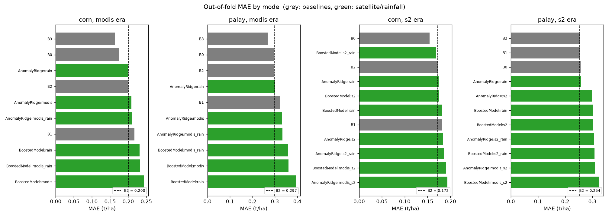
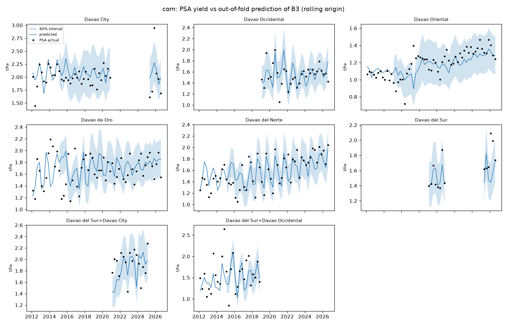
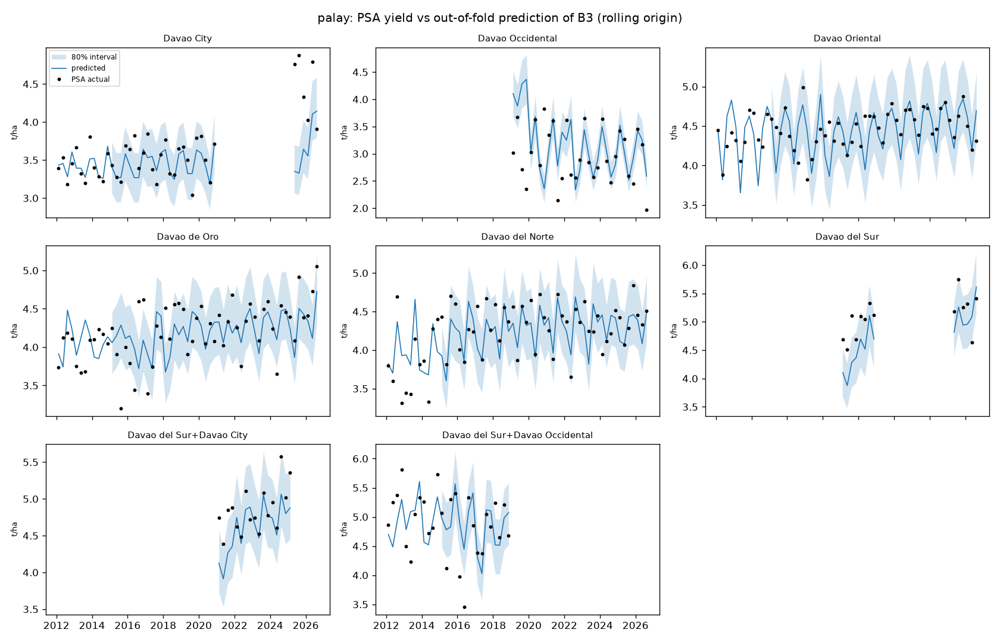
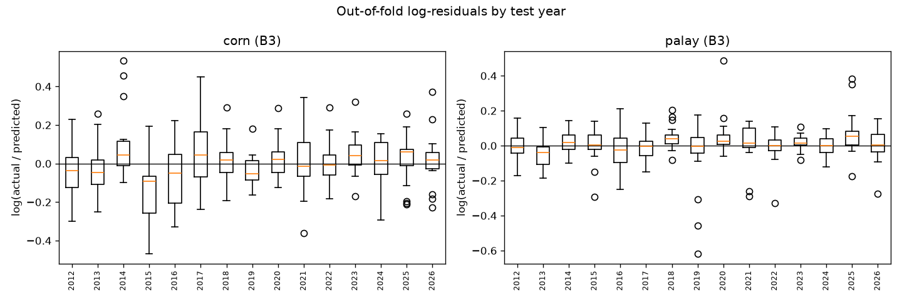

# Phase 2 results: modeling and evaluation

Generated by `cropyield select` (`src/cropyield/models/select.py`, `src/cropyield/models/report.py`) on 2026-11-25T17:47:43+00:00. Model metrics come from `reports/experiments.csv`; the selection table is also in `reports/selection.csv`; per-row predictions are in `data/processed/predictions.parquet`.

## Summary

**Satellite and rainfall features did not improve on the baselines.** None of the 28 satellite/rainfall model runs (AnomalyRidge and BoostedModel on every feature set, both eras, both crops) has an MAE below B2 with a 95% bootstrap CI that excludes zero; 22 of them are significantly worse than B2.

- **corn: B3.** B3 has the lowest MAE (0.1628 t/ha) among the candidates whose MAE - MAE(B2) 95% CI excludes zero (-0.0373 [-0.0510, -0.0248]); also qualifying: B0. B3 was added after seeing the B0/B2 test-fold results, so this CI is optimistic.
- **palay: B3.** B3 has the lowest MAE (0.2682 t/ha) among the candidates whose MAE - MAE(B2) 95% CI excludes zero (-0.0292 [-0.0433, -0.0138]). B3 was added after seeing the B0/B2 test-fold results, so this CI is optimistic.

Best satellite/rainfall run per crop and era (point MAE, Δ vs B2 [95% CI]):

- corn, modis era: AnomalyRidge:rain MAE 0.1994 t/ha, Δ -0.0007 [-0.0023, +0.0007]
- palay, modis era: AnomalyRidge:rain MAE 0.3000 t/ha, Δ +0.0026 [-0.0014, +0.0071]
- corn, s2 era: BoostedModel:s2_rain MAE 0.1684 t/ha, Δ -0.0037 [-0.0313, +0.0159]
- palay, s2 era: AnomalyRidge:rain MAE 0.2584 t/ha, Δ +0.0048 [+0.0013, +0.0097]

## Setup

- Target: log(yield_t_ha); metrics on yield_t_ha after exp(). MAE and RMSE in t/ha, MAPE in %. Δ = MAE(model) − MAE(reference) in t/ha (negative = model better); 95% CI from a paired bootstrap resampling whole test years (2,000 draws, seed 42).
- Rolling origin, expanding window, one test year per fold. MODIS era: rows from 2002, test years 2012–2026 (15 folds, 10–24 training years per fold). Sentinel-2 era: rows from 2018, test years from 2021.
- Baselines: B0 same quarter last year (falls back to B1 when last year is missing); B1 unit-quarter mean; B2 B1 plus a per-crop linear year trend; B3 mean of the B0 and B2 log-predictions (post hoc, see caveats).

| test year | train years | train from | train rows | test rows |
|---|---|---|---|---|
| 2012 | 10 | 2002 | 400 | 40 |
| 2013 | 11 | 2002 | 440 | 40 |
| 2014 | 12 | 2002 | 480 | 40 |
| 2015 | 13 | 2002 | 520 | 40 |
| 2016 | 14 | 2002 | 560 | 40 |
| 2017 | 15 | 2002 | 600 | 40 |
| 2018 | 16 | 2002 | 640 | 40 |
| 2019 | 17 | 2002 | 680 | 48 |
| 2020 | 18 | 2002 | 728 | 48 |
| 2021 | 19 | 2002 | 776 | 40 |
| 2022 | 20 | 2002 | 816 | 40 |
| 2023 | 21 | 2002 | 856 | 40 |
| 2024 | 22 | 2002 | 896 | 40 |
| 2025 | 23 | 2002 | 936 | 46 |
| 2026 | 24 | 2002 | 982 | 36 |

## Model selection (MODIS era decides)

Rule: per crop, among B0, B2, B3 and the best satellite/rainfall model (lowest MODIS-era MAE among AnomalyRidge / BoostedModel × {modis, rain, modis_rain}, as logged with ridge alpha = 1), pick the lowest-MAE candidate whose MAE − MAE(B2) 95% CI lies entirely below zero; if none qualifies, pick B2. Sentinel-2-era results are shown below but not used.

**Caveats.** B3 and the "best satellite model" were chosen after seeing the test-fold results, so their CIs are optimistic. Several comparisons are made per crop (each candidate vs B2 and vs B0) without multiple-comparison correction. The CIs resample only 15 test years.

### corn

| candidate | role | n | MAE | RMSE | MAPE % | Δ vs B2 [95% CI] | Δ vs B0 [95% CI] | CI vs B2 < 0 | selected |
|---|---|---|---|---|---|---|---|---|---|
| B0 | naive baseline | 309 | 0.1757 | 0.2491 | 11.09 | -0.0245 [-0.0455, -0.0028] | (reference) | yes |  |
| B2 | reference baseline | 309 | 0.2002 | 0.2658 | 13.03 | (reference) | +0.0245 [+0.0028, +0.0455] | no |  |
| B3 | post hoc blend of B0 and B2 | 309 | 0.1628 | 0.2267 | 10.45 | -0.0373 [-0.0510, -0.0248] | -0.0129 [-0.0240, -0.0017] | yes | **yes** |
| AnomalyRidge:rain | best satellite/rainfall model (chosen post hoc) | 309 | 0.1994 | 0.2656 | 12.97 | -0.0007 [-0.0023, +0.0007] | +0.0237 [+0.0023, +0.0445] | no |  |

Selected: **B3**. B3 has the lowest MAE (0.1628 t/ha) among the candidates whose MAE - MAE(B2) 95% CI excludes zero (-0.0373 [-0.0510, -0.0248]); also qualifying: B0.

### palay

| candidate | role | n | MAE | RMSE | MAPE % | Δ vs B2 [95% CI] | Δ vs B0 [95% CI] | CI vs B2 < 0 | selected |
|---|---|---|---|---|---|---|---|---|---|
| B0 | naive baseline | 309 | 0.2957 | 0.4239 | 7.41 | -0.0017 [-0.0251, +0.0238] | (reference) | no |  |
| B2 | reference baseline | 309 | 0.2974 | 0.4185 | 7.48 | (reference) | +0.0017 [-0.0238, +0.0251] | no |  |
| B3 | post hoc blend of B0 and B2 | 309 | 0.2682 | 0.3884 | 6.75 | -0.0292 [-0.0433, -0.0138] | -0.0275 [-0.0436, -0.0124] | yes | **yes** |
| AnomalyRidge:rain | best satellite/rainfall model (chosen post hoc) | 309 | 0.3000 | 0.4201 | 7.54 | +0.0026 [-0.0014, +0.0071] | +0.0043 [-0.0203, +0.0280] | no |  |

Selected: **B3**. B3 has the lowest MAE (0.2682 t/ha) among the candidates whose MAE - MAE(B2) 95% CI excludes zero (-0.0292 [-0.0433, -0.0138]).

## Final models

- `models/corn.joblib`: B3, fitted on every MODIS-era row (2002–2026) of both crops, as in cross-validation.
- `models/palay.joblib`: B3, fitted on every MODIS-era row (2002–2026) of both crops, as in cross-validation.
- A model that uses B0 needs last year's same-quarter PSA yield at forecast time: refit with the latest PSA year before forecasting. Where that value is missing (reporting-unit regroupings), B0 falls back to B1, the unit-quarter mean.
- The saved bundle holds the fitted model, its feature list, training period and the 80% interval offsets from all out-of-fold residuals of that crop.

## All models by crop and era

From `reports/experiments.csv` (latest row per model, era and crop). B3 was run on the MODIS era only. Δ vs B2 is the paired bootstrap difference.

### corn, modis era

| model | test years | n | MAE | RMSE | MAPE % | MAE no outliers | Δ vs B2 [95% CI] |
|---|---|---|---|---|---|---|---|
| B3 | 2012-2026 | 309 | 0.1628 | 0.2267 | 10.45 | 0.1619 | -0.0373 [-0.0510, -0.0248] |
| B0 | 2012-2026 | 309 | 0.1757 | 0.2491 | 11.09 | 0.1751 | -0.0245 [-0.0455, -0.0028] |
| AnomalyRidge:rain | 2012-2026 | 309 | 0.1994 | 0.2656 | 12.97 | 0.1984 | -0.0007 [-0.0023, +0.0007] |
| B2 | 2012-2026 | 309 | 0.2002 | 0.2658 | 13.03 | 0.1992 | (reference) |
| AnomalyRidge:modis | 2012-2026 | 309 | 0.2092 | 0.2741 | 13.60 | 0.2077 | +0.0091 [+0.0021, +0.0171] |
| AnomalyRidge:modis_rain | 2012-2026 | 309 | 0.2098 | 0.2753 | 13.62 | 0.2083 | +0.0097 [+0.0023, +0.0181] |
| B1 | 2012-2026 | 309 | 0.2169 | 0.2770 | 13.46 | 0.2167 | +0.0168 [-0.0116, +0.0413] |
| BoostedModel:rain | 2012-2026 | 309 | 0.2317 | 0.3005 | 14.28 | 0.2323 | +0.0316 [+0.0062, +0.0551] |
| BoostedModel:modis_rain | 2012-2026 | 309 | 0.2323 | 0.3091 | 14.21 | 0.2308 | +0.0321 [+0.0075, +0.0582] |
| BoostedModel:modis | 2012-2026 | 309 | 0.2436 | 0.3114 | 15.07 | 0.2423 | +0.0434 [+0.0238, +0.0646] |

### palay, modis era

| model | test years | n | MAE | RMSE | MAPE % | MAE no outliers | Δ vs B2 [95% CI] |
|---|---|---|---|---|---|---|---|
| B3 | 2012-2026 | 309 | 0.2682 | 0.3884 | 6.75 | 0.2612 | -0.0292 [-0.0433, -0.0138] |
| B0 | 2012-2026 | 309 | 0.2957 | 0.4239 | 7.41 | 0.2909 | -0.0017 [-0.0251, +0.0238] |
| B2 | 2012-2026 | 309 | 0.2974 | 0.4185 | 7.48 | 0.2889 | (reference) |
| AnomalyRidge:rain | 2012-2026 | 309 | 0.3000 | 0.4201 | 7.54 | 0.2915 | +0.0026 [-0.0014, +0.0071] |
| B1 | 2012-2026 | 309 | 0.3231 | 0.4389 | 7.97 | 0.3155 | +0.0257 [+0.0057, +0.0470] |
| AnomalyRidge:modis | 2012-2026 | 309 | 0.3306 | 0.4621 | 8.30 | 0.3211 | +0.0333 [+0.0171, +0.0487] |
| AnomalyRidge:modis_rain | 2012-2026 | 309 | 0.3334 | 0.4673 | 8.36 | 0.3236 | +0.0361 [+0.0189, +0.0529] |
| BoostedModel:modis_rain | 2012-2026 | 309 | 0.3595 | 0.4849 | 9.08 | 0.3514 | +0.0622 [+0.0179, +0.1086] |
| BoostedModel:modis | 2012-2026 | 309 | 0.3599 | 0.4839 | 9.09 | 0.3518 | +0.0626 [+0.0227, +0.1072] |
| BoostedModel:rain | 2012-2026 | 309 | 0.3927 | 0.5231 | 9.92 | 0.3854 | +0.0954 [+0.0456, +0.1433] |

### corn, s2 era

| model | test years | n | MAE | RMSE | MAPE % | MAE no outliers | Δ vs B2 [95% CI] |
|---|---|---|---|---|---|---|---|
| B0 | 2021-2026 | 121 | 0.1543 | 0.2232 | 9.10 | 0.1518 | -0.0178 [-0.0428, +0.0064] |
| BoostedModel:s2_rain | 2021-2026 | 121 | 0.1684 | 0.2323 | 9.83 | 0.1664 | -0.0037 [-0.0313, +0.0159] |
| B2 | 2021-2026 | 121 | 0.1721 | 0.2305 | 10.22 | 0.1699 | (reference) |
| AnomalyRidge:rain | 2021-2026 | 121 | 0.1742 | 0.2323 | 10.36 | 0.1719 | +0.0021 [+0.0001, +0.0047] |
| BoostedModel:s2 | 2021-2026 | 121 | 0.1757 | 0.2388 | 10.30 | 0.1721 | +0.0036 [-0.0223, +0.0211] |
| BoostedModel:rain | 2021-2026 | 121 | 0.1817 | 0.2422 | 10.56 | 0.1803 | +0.0096 [-0.0027, +0.0213] |
| B1 | 2021-2026 | 121 | 0.1823 | 0.2411 | 10.75 | 0.1802 | +0.0102 [+0.0003, +0.0237] |
| AnomalyRidge:s2 | 2021-2026 | 121 | 0.1832 | 0.2387 | 10.89 | 0.1814 | +0.0111 [+0.0040, +0.0225] |
| AnomalyRidge:s2_rain | 2021-2026 | 121 | 0.1859 | 0.2420 | 11.06 | 0.1842 | +0.0138 [+0.0038, +0.0281] |
| BoostedModel:modis_s2 | 2021-2026 | 121 | 0.1907 | 0.2464 | 11.19 | 0.1870 | +0.0186 [-0.0012, +0.0387] |
| AnomalyRidge:modis_s2 | 2021-2026 | 121 | 0.1935 | 0.2483 | 11.69 | 0.1903 | +0.0213 [+0.0129, +0.0299] |

### palay, s2 era

| model | test years | n | MAE | RMSE | MAPE % | MAE no outliers | Δ vs B2 [95% CI] |
|---|---|---|---|---|---|---|---|
| B2 | 2021-2026 | 121 | 0.2536 | 0.3617 | 6.33 | 0.2470 | (reference) |
| B1 | 2021-2026 | 121 | 0.2558 | 0.3710 | 6.32 | 0.2487 | +0.0022 [-0.0027, +0.0075] |
| B0 | 2021-2026 | 121 | 0.2562 | 0.3830 | 6.58 | 0.2498 | +0.0026 [-0.0311, +0.0359] |
| AnomalyRidge:rain | 2021-2026 | 121 | 0.2584 | 0.3656 | 6.45 | 0.2518 | +0.0048 [+0.0013, +0.0097] |
| AnomalyRidge:s2 | 2021-2026 | 121 | 0.2973 | 0.3976 | 7.28 | 0.2925 | +0.0437 [+0.0155, +0.0736] |
| BoostedModel:rain | 2021-2026 | 121 | 0.3007 | 0.4149 | 8.04 | 0.2930 | +0.0471 [+0.0209, +0.0793] |
| BoostedModel:s2 | 2021-2026 | 121 | 0.3013 | 0.4042 | 7.66 | 0.2957 | +0.0477 [+0.0273, +0.0666] |
| AnomalyRidge:s2_rain | 2021-2026 | 121 | 0.3070 | 0.4128 | 7.50 | 0.3024 | +0.0534 [+0.0190, +0.0874] |
| BoostedModel:s2_rain | 2021-2026 | 121 | 0.3074 | 0.4204 | 8.04 | 0.3007 | +0.0538 [+0.0315, +0.0733] |
| AnomalyRidge:modis_s2 | 2021-2026 | 121 | 0.3087 | 0.4229 | 7.59 | 0.3038 | +0.0551 [+0.0270, +0.0837] |
| BoostedModel:modis_s2 | 2021-2026 | 121 | 0.3248 | 0.4381 | 8.37 | 0.3176 | +0.0712 [+0.0381, +0.0949] |

## Errors per reporting unit (selected models)

Out-of-fold MODIS-era test rows. MAE of B0 and B2 on the same rows for reference.

| crop | model | reporting unit | n | MAE | RMSE | MAPE % | MAE B0 | MAE B2 |
|---|---|---|---|---|---|---|---|---|
| corn | B3 | Davao City | 42 | 0.1616 | 0.2108 | 8.39 | 0.1497 | 0.2302 |
| corn | B3 | Davao Occidental | 31 | 0.1384 | 0.1896 | 9.29 | 0.1439 | 0.1538 |
| corn | B3 | Davao Oriental | 59 | 0.0880 | 0.1214 | 7.66 | 0.0862 | 0.1142 |
| corn | B3 | Davao de Oro | 59 | 0.2089 | 0.2767 | 13.02 | 0.2282 | 0.2864 |
| corn | B3 | Davao del Norte | 59 | 0.1371 | 0.1826 | 9.29 | 0.1432 | 0.1766 |
| corn | B3 | Davao del Sur | 14 | 0.1573 | 0.2355 | 8.82 | 0.1762 | 0.1742 |
| corn | B3 | Davao del Sur+Davao City | 17 | 0.2530 | 0.3069 | 13.52 | 0.2892 | 0.2183 |
| corn | B3 | Davao del Sur+Davao Occidental | 28 | 0.2546 | 0.3360 | 16.72 | 0.3272 | 0.2574 |
| palay | B3 | Davao City | 42 | 0.2264 | 0.3980 | 5.60 | 0.2567 | 0.2556 |
| palay | B3 | Davao Occidental | 31 | 0.4130 | 0.6540 | 15.11 | 0.4302 | 0.4146 |
| palay | B3 | Davao Oriental | 59 | 0.1869 | 0.2606 | 4.28 | 0.1810 | 0.2943 |
| palay | B3 | Davao de Oro | 59 | 0.2614 | 0.3459 | 6.40 | 0.3017 | 0.2579 |
| palay | B3 | Davao del Norte | 59 | 0.2093 | 0.2649 | 5.04 | 0.2362 | 0.2459 |
| palay | B3 | Davao del Sur | 14 | 0.4361 | 0.4653 | 8.70 | 0.4813 | 0.3910 |
| palay | B3 | Davao del Sur+Davao City | 17 | 0.2662 | 0.3381 | 5.43 | 0.2798 | 0.2613 |
| palay | B3 | Davao del Sur+Davao Occidental | 28 | 0.3976 | 0.4823 | 8.53 | 0.4766 | 0.4030 |

## 80% prediction intervals

For crop c and test year Y, the interval is exp(prediction + q) with q the 10% and 90% empirical quantiles of the selected model's out-of-fold log-residuals of crop c in test years before Y only, so no residual from year Y or later is used. The first 3 test years have fewer than 3 earlier years of residuals and get no interval (NaN). The saved final models use the quantiles of all out-of-fold residuals of their crop for forecasts. Empirical coverage on the rows that have an interval:

| crop | model | years | rows with interval | coverage | below | above | mean width t/ha |
|---|---|---|---|---|---|---|---|
| corn | B3 | 2015-2026 | 249 | 84.3% | 6.8% | 8.8% | 0.597 |
| palay | B3 | 2015-2026 | 249 | 81.5% | 8.0% | 10.4% | 0.844 |

## Conditions vs normal (app columns, not model inputs)

`predictions.parquet` keeps these per row although the selected models do not use them:

- `modis_ndvi_peak_anom` ("MODIS NDVI peak vs normal"): modis_ndvi_peak minus its mean over earlier years (< year, MODIS era from 2002) of the same reporting unit, crop and quarter; NaN with fewer than 3 earlier values. Conditions vs normal; not a model input.
- `modis_ndvi_integral_anom` ("MODIS NDVI integral vs normal"): modis_ndvi_integral minus its mean over earlier years (< year, MODIS era from 2002) of the same reporting unit, crop and quarter; NaN with fewer than 3 earlier values. Conditions vs normal; not a model input.
- `modis_evi_peak_anom` ("MODIS EVI peak vs normal"): modis_evi_peak minus its mean over earlier years (< year, MODIS era from 2002) of the same reporting unit, crop and quarter; NaN with fewer than 3 earlier values. Conditions vs normal; not a model input.
- `modis_evi_integral_anom` ("MODIS EVI integral vs normal"): modis_evi_integral minus its mean over earlier years (< year, MODIS era from 2002) of the same reporting unit, crop and quarter; NaN with fewer than 3 earlier values. Conditions vs normal; not a model input.
- `rain_anom` ("Rainfall vs normal (mm)"): growing-window rainfall (mm) minus the unit's fixed 1981-2000 ERA5 month-of-year climatology (features.py). Conditions vs normal; not a model input.

The NDVI/EVI anomalies need at least 3 earlier values of the same unit, crop and quarter, so units created by a regrouping have no anomaly for their first 3 years. Source features: modis_ndvi_peak, modis_ndvi_integral, modis_evi_peak, modis_evi_integral.

`rain_anom` is shifted: its mean is +133 mm over all modeling-table rows (1987–2026) and +198 mm over MODIS-era rows (2002–2026), i.e. recent windows are wetter than the 1981–2000 ERA5 climatology. This may be a real trend or drift in the ERA5 reanalysis; the app should not read a positive value as unusual without this context.

## Exploratory: ridge alpha sweep

Exploratory check, recomputed by `report.alpha_sweep`; not logged to experiments.csv and not used for selection (the logged models use alpha = 1). AnomalyRidge Δ vs B2 [95% CI]:

| feature_set | era | crop | α = 1 | α = 100 | α = 1000 |
|---|---|---|---|---|---|
| rain | modis | corn | -0.0007 [-0.0023, +0.0007] | -0.0006 [-0.0021, +0.0007] | -0.0003 [-0.0012, +0.0006] |
| rain | modis | palay | +0.0026 [-0.0014, +0.0071] | +0.0022 [-0.0017, +0.0063] | +0.0011 [-0.0014, +0.0038] |
| rain | s2 | corn | +0.0021 [+0.0001, +0.0047] | +0.0017 [+0.0004, +0.0034] | +0.0007 [+0.0002, +0.0014] |
| rain | s2 | palay | +0.0048 [+0.0013, +0.0097] | +0.0034 [+0.0008, +0.0072] | +0.0012 [+0.0001, +0.0028] |
| modis_rain | modis | corn | +0.0097 [+0.0023, +0.0181] | +0.0061 [-0.0007, +0.0135] | +0.0010 [-0.0027, +0.0045] |
| modis_rain | modis | palay | +0.0361 [+0.0189, +0.0529] | +0.0250 [+0.0081, +0.0410] | +0.0053 [-0.0073, +0.0175] |
| s2_rain | s2 | corn | +0.0138 [+0.0038, +0.0281] | +0.0052 [+0.0022, +0.0081] | +0.0016 [+0.0006, +0.0024] |
| s2_rain | s2 | palay | +0.0534 [+0.0190, +0.0874] | +0.0238 [+0.0086, +0.0398] | +0.0066 [+0.0021, +0.0114] |

In 8 of 8 rows |Δ| at alpha = 1000 is no larger than at alpha = 1, and 0 of 24 cells have a CI entirely below zero.
Stronger shrinkage pulls every ridge towards B2 (Δ → 0) and never produces a gain, so the ridge losses at alpha = 1 come from over-fitting noise, not from a signal that better tuning would recover.

## Why satellites and rainfall did not help (likely reasons)

- The ESA WorldCover cropland class mixes rice and corn with plantations (coconut, banana and other tree crops), so province-mean NDVI/EVI mostly tracks non-target vegetation.
- Mapped cropland is small in places: Davao Occidental 286 ha, Davao City 2,323 ha, Davao Oriental 7,023 ha, Davao de Oro 13,793 ha, Davao del Sur 18,539 ha, Davao del Norte 20,694 ha (WorldCover cropland, `data/interim/rainfall_points.csv`).
- Quarterly PSA survey estimates are noisy, and at province-quarter level that noise can swamp a weather or greenness signal.
- The Sentinel-2 era has only 6 test years (2021-2026), so its CIs are wide.
- BoostedModel has no year input and cannot follow the yield trend that B2 captures.

## Other limitations

- Reporting-unit regroupings break B0 (no same-unit value last year) and shorten B1/B2 histories, so these rows use crude fallbacks. Rows where B0 fell back to B1 (unit, year: rows): Davao City 2025: 6; Davao City 2026: 2; Davao Occidental 2019: 8; Davao del Sur 2019: 8; Davao del Sur 2025: 6; Davao del Sur 2026: 2; Davao del Sur+Davao City 2021: 8.
- 2026 covers quarters Q1, Q2, Q3 only, and recent PSA figures are likely provisional.
- The cropland mask is a single 2020/21 WorldCover snapshot applied to every year.
- Rainfall is ERA5 reanalysis on a ~0.25° (~28 km) grid at one point per province, not gauge-corrected.

## Next steps

- A rice-paddy mask (an existing paddy map, or Sentinel-1/2 phenology-based mapping) so indices average over rice fields only; a separate corn mask.
- Sentinel-1 SAR flood/inundation detection for rice transplanting timing and planted area (cloud-independent).
- Re-evaluate with more Sentinel-2 years as they accumulate.

## predictions.parquet columns

| column | definition |
|---|---|
| reporting_unit | PSA reporting unit (combined units as reported, e.g. 'A+B') |
| crop | palay or corn |
| year | calendar year |
| quarter | calendar quarter 1-4 |
| quality_flag | Phase 1 quality flag of the PSA row |
| is_outlier | quality_flag contains 'outlier' |
| model | selected model for this crop (B0, B2, B3 or '<model>:<feature_set>') |
| actual_yield_t_ha | PSA yield (t/ha) |
| pred_yield_t_ha | out-of-fold prediction of the selected model, exp(pred log-yield) |
| pred_lo_t_ha | 80% interval low: exp(pred log-yield + 10th pct of earlier-fold log-residuals of this crop); NaN for the first folds |
| pred_hi_t_ha | 80% interval high: same with the 90th percentile |
| interval_n_years | earlier test years whose residuals built the interval |
| b2_pred_yield_t_ha | out-of-fold B2 (unit-quarter mean + trend) prediction |
| b0_pred_yield_t_ha | out-of-fold B0 (same quarter last year) prediction |
| b0_fallback | B0 had no same-quarter value for year-1 and used B1 (unit-quarter mean); happens at reporting-unit regroupings |
| area_ha | PSA harvested area (ha) |
| actual_production_mt | PSA production (t) |
| pred_production_mt | pred_yield_t_ha x area_ha (PSA area, known at release) |
| n_train_years | training years in this row's fold |
| modis_ndvi_peak_anom | modis_ndvi_peak minus its mean over earlier years (< year, MODIS era from 2002) of the same reporting unit, crop and quarter; NaN with fewer than 3 earlier values. Conditions vs normal; not a model input |
| modis_ndvi_integral_anom | modis_ndvi_integral minus its mean over earlier years (< year, MODIS era from 2002) of the same reporting unit, crop and quarter; NaN with fewer than 3 earlier values. Conditions vs normal; not a model input |
| modis_evi_peak_anom | modis_evi_peak minus its mean over earlier years (< year, MODIS era from 2002) of the same reporting unit, crop and quarter; NaN with fewer than 3 earlier values. Conditions vs normal; not a model input |
| modis_evi_integral_anom | modis_evi_integral minus its mean over earlier years (< year, MODIS era from 2002) of the same reporting unit, crop and quarter; NaN with fewer than 3 earlier values. Conditions vs normal; not a model input |
| rain_anom | growing-window rainfall (mm) minus the unit's fixed 1981-2000 ERA5 month-of-year climatology (features.py). Conditions vs normal; not a model input |
